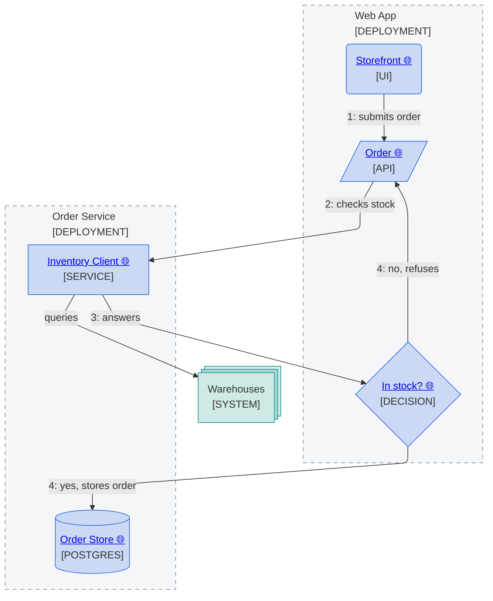

<!--
Purpose: Conventions and examples for static application structure, ownership, dependency, and trust diagrams.
Type: reference
-->

# Application Diagrams

> **Audience:** the writer, when a reader needs application structure rather than request order.

Use `graph TD`. Show components at one abstraction level. A deployable
service, in-process module, API boundary, and stored payload belong together
only when their dependency is the point of the diagram.

## Table of Contents

- [Grammar](#grammar)
- [Boundaries](#boundaries)
- [Example](#example)

## Grammar

| Element | Rule |
| --- | --- |
| Node label | `Title<br/>[TYPE]`, quoted, with TYPE from the closed list below. |
| Title | One to three words that never repeat the tag, [linked](mermaid.md#source-links) if it has a source. A plural title is [stacked](mermaid-visual.md#shapes). |
| Shape | Chosen by TYPE from the table below, in classic Mermaid syntax that every viewer draws. |
| Step numbers | Prefix `1:`, `2:` in a flow, for order only. A DECISION's answers share one number; side edges take none. |
| Forbidden | Horizontal flowcharts, decorative subgraphs, and ASCII diagrams. |

| TYPE | Means | Shape | Syntax |
| --- | --- | --- | --- |
| PERSON | A human actor | Stadium | `id(["..."])` |
| TEAM | An owning team | Rectangle | `id["..."]` |
| UI | Rendered browser surface | Rounded box | `id("...")` |
| API | HTTP route or endpoint | Parallelogram | `id[/"..."/]` |
| AGENT | LLM-driven runner | Hexagon | `id{{"..."}}` |
| TOOL | A callable agent tool | Subroutine | `id[["..."]]` |
| SERVICE | Deterministic module | Rectangle | `id["..."]` |
| SYSTEM | A whole deployment | Rectangle | `id["..."]` |
| DATA | Payload, contract or in-memory state | Cylinder | `id[("...")]` |
| Named technology | A store's engine, a vendor service or a runtime, from the list below | Cylinder for a store, otherwise rectangle | `id[("...")]`, `id["..."]` |
| DECISION | A branch taken in code | Rhombus | `id{"..."}` |

A DECISION is a branch in code:

- Its title is a question in sentence case, an exception to Title Case: "In stock?".
- It holds three words at most, since a rhombus balloons around a longer label.
- Each edge out of it opens with one answer, then its verb: `yes, stores order`.
- It takes that code's owner class. A model's choice branches from the `[AGENT]` node instead,
  and each of those edges names one answer too.

A TOOL node never ends the flow. Draw an edge from it to the node or person
that gets its result: the service it calls, the store it edits, or the person
who sees its output.

Choose the TYPE by what the code is, not by what it is called:

- TOOL only for a function the model can call.
  - Code that runs before or after the model, such as a route or a callback, is a SERVICE, even
    when it picks a tool.
- AGENT only for a runner that calls a model.
- API for an HTTP route or endpoint. A library, or a module of helper functions, is a SERVICE.
- SYSTEM for a whole system of several parts, or a third-party product not on the list below.
- DATA for a payload, a contract or in-memory state. A store never takes DATA.
- A store, a vendor service or a runtime whose technology is known names it:
  - Stores: `POSTGRES`, `MYSQL`, `SQL SERVER`, `REDIS`, `VALKEY`, `MONGODB`, `BIGQUERY`, `CLOUD STORAGE`, `S3`, `SESSION STORAGE`, `LOCAL STORAGE`, `KAFKA`.
  - Vendor services and runtimes: `VERTEX AI`, `SPEECH-TO-TEXT`, `TEXT-TO-SPEECH`, `APIGEE`, `LANGFUSE`, `ENTRA ID`, `CLOUD RUN`, `AZURE PIPELINES`, `AZURE REPOS`, `AZURE ARTIFACTS`.
  - The title still names the thing, never the technology: "Order Store [POSTGRES]", not "Postgres [POSTGRES]".

A new TYPE needs this file and the lint's type list changed together, so one
concept is never tagged two ways in two documents.

## Boundaries

Allowed types are `TEAM`, `DEPLOYMENT`, `TRUST BOUNDARY`, and `REPO`.
Most application diagrams need no subgraph. A real boundary follows the
shared [boundary format](mermaid-visual.md#boundaries).

## Example

The block below shows a finished section as it appears in a document.

````markdown
The order API checks inventory before it stores the order.



> **Legend:** *🟦 Orders team · 🟩 Warehouse team*

1. The browser submits the customer's order.
2. The API checks stock through the inventory client.
3. The inventory client reports whether every item is in stock.
4. The API stores an order it can fill, and refuses the rest.
````
