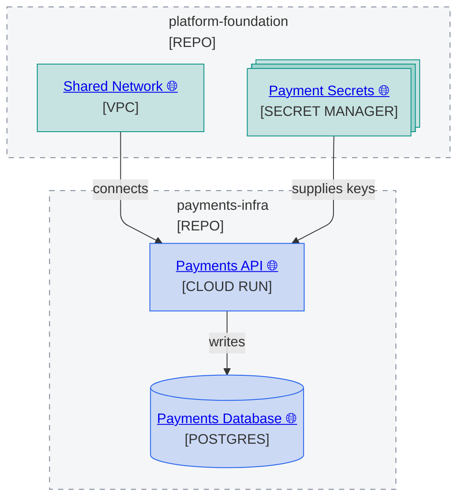

<!--
Purpose: Conventions for professional provisioning diagrams across repositories, clouds, and on-premises environments.
Type: reference
-->

# Infrastructure Diagrams

> **Audience:** the writer, when a reader needs provisioning ownership and deployed resource topology.

Use `graph TD`. Read from foundation and shared services at the top to
workloads and state below. Show repository provisioning boundaries before
resource detail when several repositories manage one environment.

## Boundaries

Allowed types are `REPO`, `ENVIRONMENT`, `NETWORK`, `TRUST BOUNDARY`,
`DATACENTER`, `SUBSCRIPTION`, and `GCP PROJECT`.

The example applies the shared [boundary format](mermaid-visual.md#boundaries):

````markdown
The foundation repository provisions the network and secrets that the payments workload consumes.



> **Legend:** *🟦 Payments team · 🟩 Platform team*
````

Never create a boundary for a layer, phase, or visual shortcut. Use one
boundary for one owner or isolation rule. Nested boundaries must express
different facts, such as repository ownership around a network boundary.

## Resource Labels

Write `Resource Name<br/>[PLATFORM SERVICE]`. Use the deployed technology or
managed service, never generic `SYSTEM`, `SERVICE`, or `DATA`.

| Context | Preferred Types |
| --- | --- |
| GCP | `CLOUD RUN`, `CLOUD RUN JOB`, `GCP PROJECT`, `VPC`, `PRIVATE SERVICE CONNECT`, `EXTERNAL LOAD BALANCER`, `CLOUD SQL`, `MEMORYSTORE`, `SECRET MANAGER` |
| Azure | `AZURE APP SERVICE`, `AZURE FUNCTIONS`, `AZURE SQL`, `VIRTUAL NETWORK`, `APPLICATION GATEWAY`, `KEY VAULT` |
| On-premises | `KUBERNETES`, `VM`, `PHYSICAL SERVER`, `POSTGRES`, `FIREWALL`, `LOAD BALANCER`, `DNS` |
| Cross-platform | `OBJECT STORAGE`, `MESSAGE BROKER`, `CONTAINER REGISTRY` |

Draw a store, `CLOUD SQL`, `AZURE SQL`, `MEMORYSTORE`, `OBJECT STORAGE`, or a
[named store](mermaid-application.md#grammar) such as `POSTGRES`, as a cylinder, `id[("...")]`, and every other resource as a rectangle, `id["..."]`.

Application diagrams also use [named technologies](mermaid-application.md#grammar) such as
`CLOUD RUN` and `POSTGRES`, so they decide nothing. The lint marks a diagram as infrastructure
only when it draws another type from the table, or a `NETWORK`, `DATACENTER`, `SUBSCRIPTION` or
`GCP PROJECT` boundary. `REPO`, `ENVIRONMENT` and `TRUST BOUNDARY` frames alone do not count.

Use a specific engine such as `POSTGRES` when it helps the reader more than
the hosting product. Add a new uppercase type only when it is the official
service or technology name and existing types would mislead. Add it to this table as the
[application reference](mermaid-application.md#grammar) says for a new TYPE.

## Layout

- Keep foundational repositories above repositories that consume their resources.
- Use one box per independently deployed resource when failure or ownership differs.
- Group repeated instances only when they share lifecycle, owner, and platform type.
  Draw the group as one [stacked node](mermaid-visual.md#shapes).
- Omit monitoring, IAM bindings, and helper resources unless they explain the requested boundary.

For a multi-repository environment, show every provisioning boundary but
expand only the boundary relevant to the document. Keep the other boundaries
compact enough to preserve ownership context.
