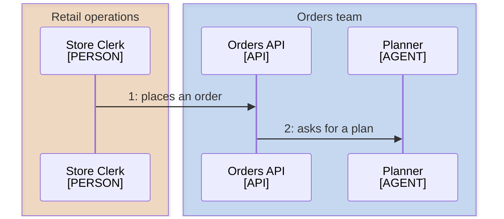

<!--
Purpose: Conventions for ordered request, lifecycle, authentication, and orchestration diagrams.
Type: reference
-->

# Runtime Diagrams

Audience: the writer, when a reader needs to trace events in order.

Use `sequenceDiagram`. Put the initiating person first, then participants in
call order, kept together by owner band. Every participant uses
`participant`, a `PERSON` included. Never use `actor`: its figure collides
with a two-line label.

## Participants and Messages

Use the application node vocabulary. Label every participant as
`Title<br/>[TYPE]`. Number every message as `1: text` and keep its text to one action.

- Solid arrows are calls or commands.
- Dashed arrows are responses.
- Use `opt` for optional behavior and `alt` for mutually exclusive outcomes.
- Split by phase before exceeding seven participants or twelve messages.
- Do not add a participant only to hold a note.

Sequence diagrams draw no deployment or trust boundaries. When those matter
more than order, create a separate application or infrastructure diagram.

## Owner Bands

Every participant sits in one owner band, so a box keeps the owner color it
has in every flowchart. A band is `box <color> <owner name>`, its participant
lines, then `end`. Mermaid reads `#` in a `box` line as a comment, so a band
takes the `rgba` form of its owner's [palette](mermaid.md#color) fill.

| Class | Band Color |
| --- | --- |
| `own` | `rgba(26,115,232,0.2)` |
| `peer` | `rgba(24,128,56,0.2)` |
| `platform` | `rgba(227,116,0,0.2)` |
| `vendor` | `rgba(95,99,104,0.2)` |

- Declare every participant inside a band; a band holds participant lines only.
  Never use `create`: Mermaid places a created participant outside every band.
- Name the real owner in the band title. The titles are the key, so a
  sequence diagram needs no legend line.
- An `[AGENT]` participant sits in its owner's band; its tag marks the model call.
- Two bands may share an owner when call order separates its participants.

````markdown


| Node | Source |
| --- | --- |
| Store Clerk | - |
| Orders API | [orders.ts](../src/api/orders.ts) |
| Planner | [planner/](../src/planner/) |
````

## Source Table

List participants in declaration order. A numbered list may combine adjacent
request and response messages when one explanation covers both without losing
an authorization, validation, or persistence boundary.
