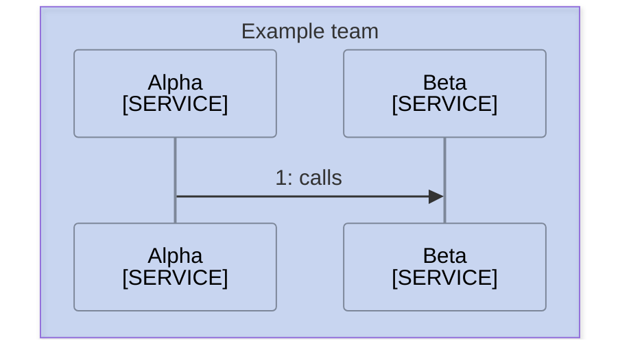
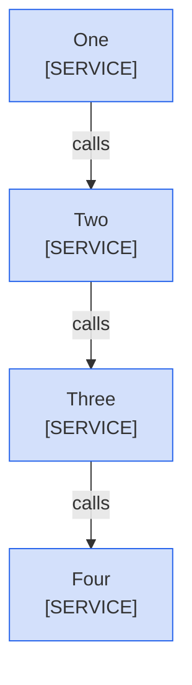

<!--
Purpose: Fixture.
Type: explanation
-->

# Title

> **Audience:** maintainers, to see one rule fail.

## Section

A Sources line sits below a paragraph instead of under the diagram.

The two services talk once.

> **Sources:** *Alpha [mmd-click.md](mmd-click.md)*

A diagram takes a second Sources line.

> **Sources:** *Alpha [mmd-click.md](mmd-click.md)*

> **Sources:** *Beta [mmd-click.md](mmd-click.md)*

A legend is not boxed.

**Legend:** *🟦 Example team*

A legend runs onto a second line.

> **Legend:** *🟦 Example team*
> *and more*
