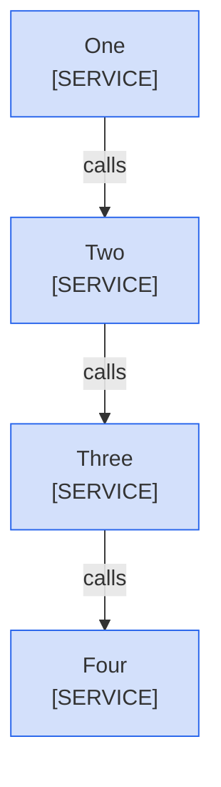
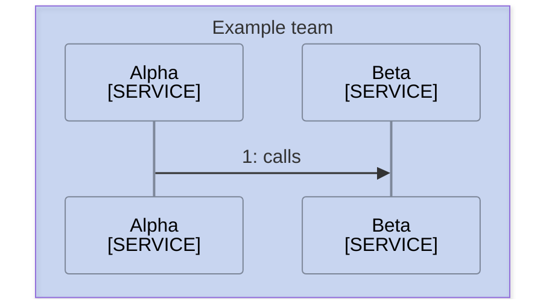

<!--
Purpose: Fixture.
Type: explanation
-->

# Title

> **Audience:** nobody.

## Section

Lead.

> **Legend:** *🟦 Example team*

A sequence diagram links a participant with the 'link' directive.

