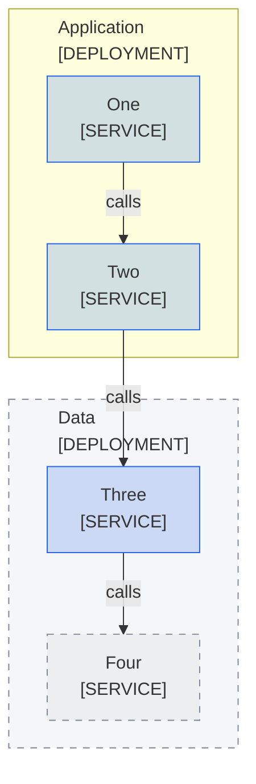

<!--
Purpose: Fixture.
Type: explanation
-->

# Color Boundary

> **Audience:** maintainers, to see one rule fail.

The block leaves one boundary plain and gives a node the boundary class.

> **Legend:** *🟦 Platform team*
