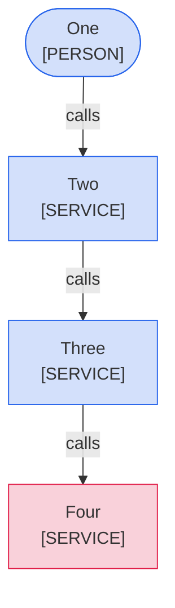

<!--
Purpose: Fixture.
Type: explanation
-->

# Color Person

> **Audience:** maintainers, to see one rule fail.

The block gives a person an owner class and a service the person class.

> **Legend:** *🟦 Platform team · 🟥 customers*
