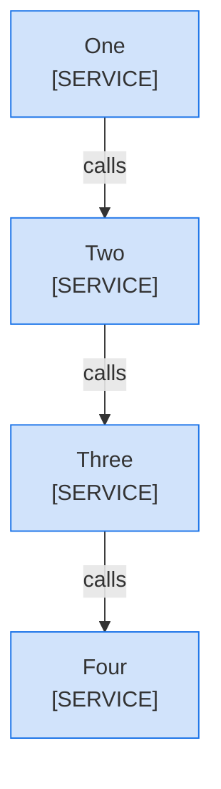
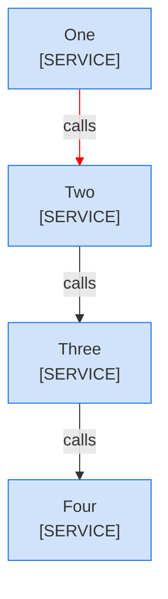
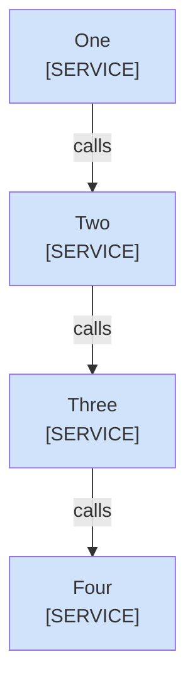
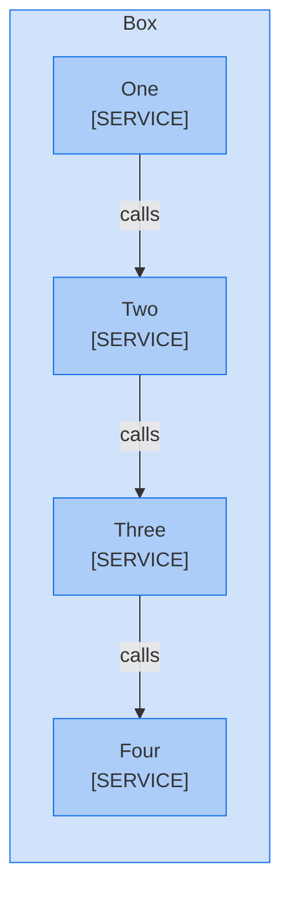
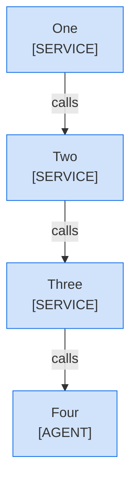
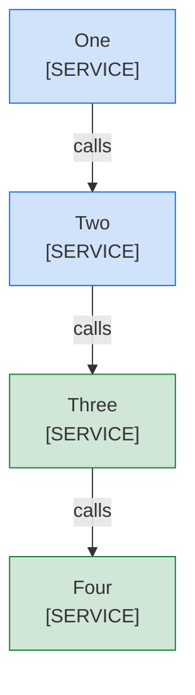
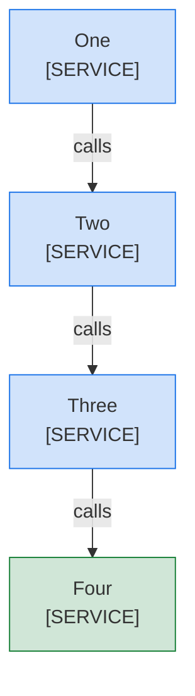

<!--
Purpose: Fixture.
Type: explanation
-->

# Color Rules

Audience: maintainers, to see each color and legend rule fail.

A ':::' shorthand colors a node.



**Legend:** 🟦 Platform team

| Node | Source |
| --- | --- |
| One | - |
| Two | - |
| Three | - |
| Four | - |

A 'linkStyle' line colors an edge.



**Legend:** 🟦 Platform team

| Node | Source |
| --- | --- |
| One | - |
| Two | - |
| Three | - |
| Four | - |

A palette class has the wrong definition.



**Legend:** 🟦 Platform team

| Node | Source |
| --- | --- |
| One | - |
| Two | - |
| Three | - |
| Four | - |

A boundary takes a color.



**Legend:** 🟦 Platform team

| Node | Source |
| --- | --- |
| Box [DEPLOYMENT] | - |
| One | - |
| Two | - |
| Three | - |
| Four | - |

An agent node takes an owner class.



**Legend:** 🟦 Platform team

| Node | Source |
| --- | --- |
| One | - |
| Two | - |
| Three | - |
| Four | - |

The legend misses a swatch.



**Legend:** 🟦 Platform team

| Node | Source |
| --- | --- |
| One | - |
| Two | - |
| Three | - |
| Four | - |

The legend names a swatch the diagram does not use.


**Legend:** 🟦 Platform team · 🟩 Partner team

| Node | Source |
| --- | --- |
| One | - |
| Two | - |
| Three | - |
| Four | - |

A sequence diagram takes a color.

```mermaid
sequenceDiagram
  participant A as Alpha<br/>[SERVICE]
  participant B as Beta<br/>[SERVICE]
  A->>B: 1: calls
  classDef own fill:#1a73e833,stroke:#1a73e8
```

| Node | Source |
| --- | --- |
| Alpha | - |
| Beta | - |

A class has no classDef.


| Node | Source |
| --- | --- |
| One | - |
| Two | - |
| Three | - |
| Four | - |

A class line names a missing node.


**Legend:** 🟦 Platform team

| Node | Source |
| --- | --- |
| One | - |
| Two | - |
| Three | - |
| Four | - |

A class line puts a space after a comma.

```mermaid
graph TD
  One["One<br/>[SERVICE]"]
  Two["Two<br/>[SERVICE]"]
  Three["Three<br/>[SERVICE]"]
  Four["Four<br/>[SERVICE]"]
  One -->|"calls"| Two
  Two -->|"calls"| Three
  Three -->|"calls"| Four
  class One, Two own
  class Three,Four own
  classDef own fill:#1a73e833,stroke:#1a73e8
```

**Legend:** 🟦 Platform team

| Node | Source |
| --- | --- |
| One | - |
| Two | - |
| Three | - |
| Four | - |

A node takes two classes.



**Legend:** 🟦 Platform team · 🟩 Partner team

| Node | Source |
| --- | --- |
| One | - |
| Two | - |
| Three | - |
| Four | - |

The legend sits under the Node table instead of the diagram.


| Node | Source |
| --- | --- |
| One | - |
| Two | - |
| Three | - |
| Four | - |

**Legend:** 🟦 Platform team

A classDef is never assigned.


**Legend:** 🟦 Platform team

| Node | Source |
| --- | --- |
| One | - |
| Two | - |
| Three | - |
| Four | - |

A node drawn only on an edge stays plain.


**Legend:** 🟦 Platform team

| Node | Source |
| --- | --- |
| One | - |
| Two | - |
| Three | - |
| Four | - |

A valid colored diagram sits above one without a lead sentence.


**Legend:** 🟦 Platform team

| Node | Source |
| --- | --- |
| One | - |
| Two | - |
| Three | - |
| Four | - |


| Node | Source |
| --- | --- |
| One | - |
| Two | - |
| Three | - |
| Four | - |

A legend runs on past one line.


**Legend:** 🟦 Platform team
and a second line that explains more.

| Node | Source |
| --- | --- |
| One | - |
| Two | - |
| Three | - |
| Four | - |

A diagram without color carries a swatch legend.


**Legend:** 🟦 Platform team

| Node | Source |
| --- | --- |
| One | - |
| Two | - |
| Three | - |
| Four | - |

A second legend sits under the Node table.


**Legend:** 🟦 Platform team

| Node | Source |
| --- | --- |
| One | - |
| Two | - |
| Three | - |
| Four | - |

**Legend:** 🟦 Platform team

The legend sits between the numbered list and the Node table.

```mermaid
graph TD
  One["One<br/>[SERVICE]"]
  Two["Two<br/>[SERVICE]"]
  Three["Three<br/>[SERVICE]"]
  Four["Four<br/>[SERVICE]"]
  One -->|"1: calls"| Two
  Two -->|"calls"| Three
  Three -->|"calls"| Four
  class One,Two,Three,Four own
  classDef own fill:#1a73e833,stroke:#1a73e8
```

1. One calls two.

**Legend:** 🟦 Platform team

| Node | Source |
| --- | --- |
| One | - |
| Two | - |
| Three | - |
| Four | - |
