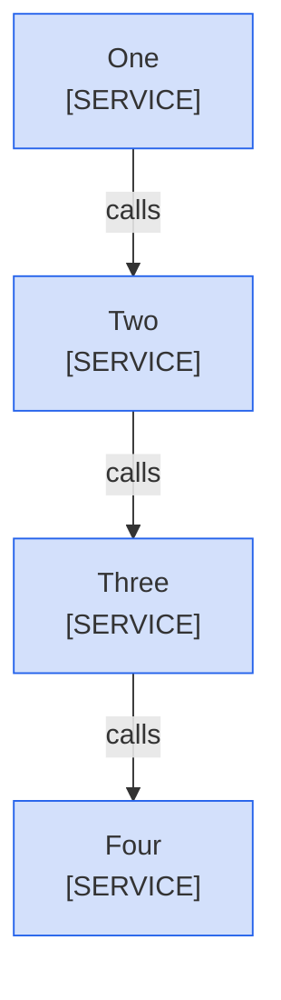
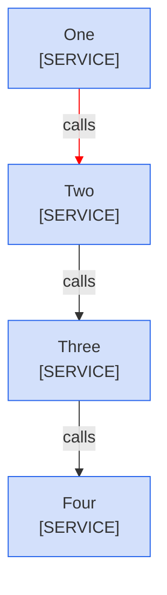
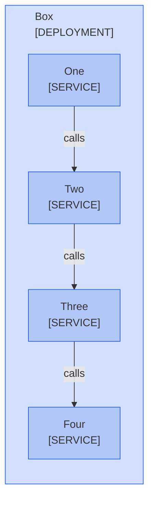
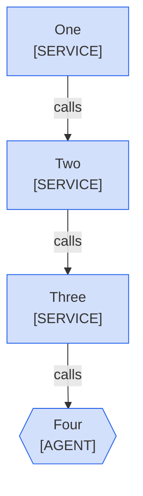
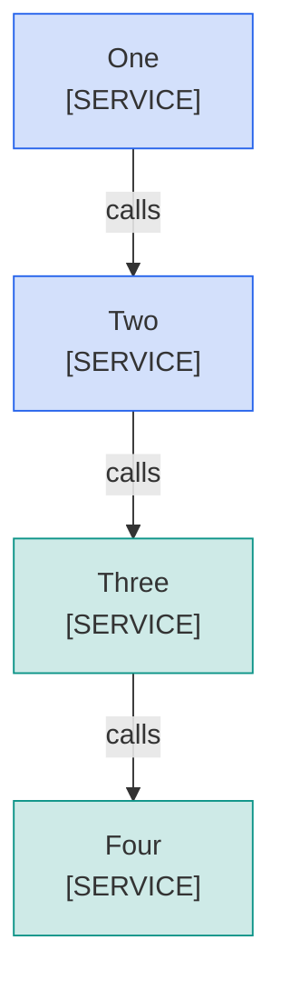
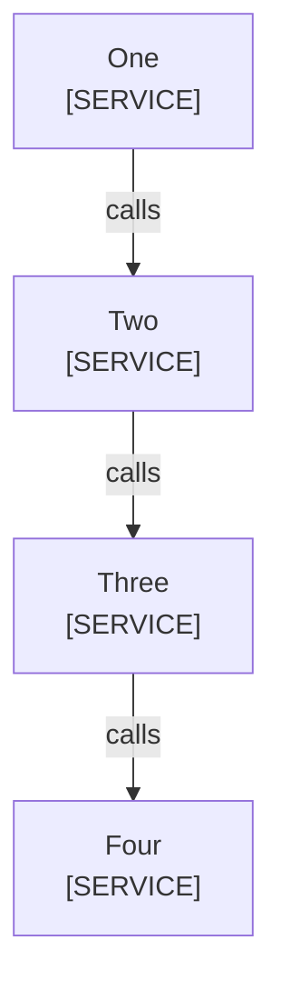
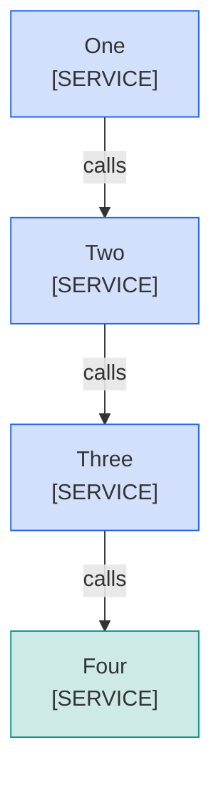
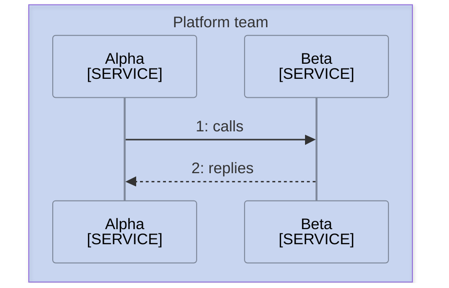
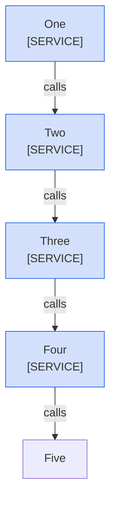
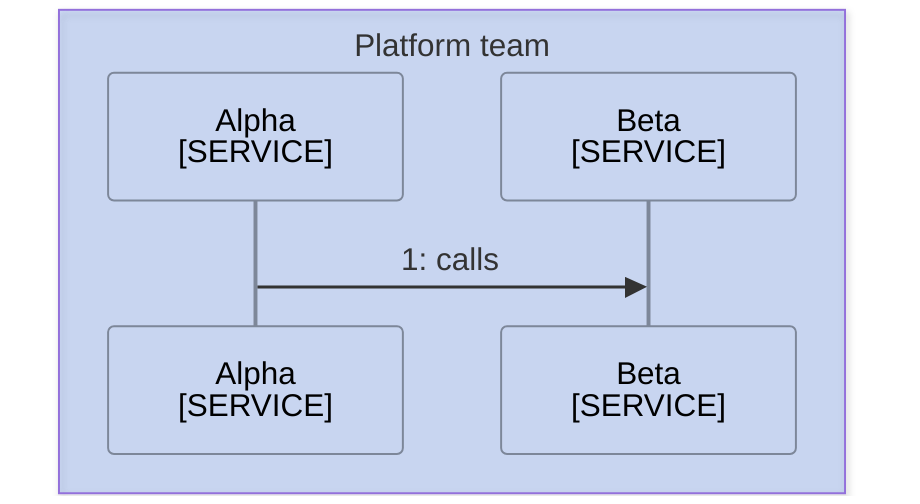

<!--
Purpose: Fixture.
Type: explanation
-->

# Color Rules

> **Audience:** maintainers, to see each color and legend rule fail.

A ':::' shorthand colors a node.



> **Legend:** *🟦 Platform team*

A 'linkStyle' line colors an edge.



> **Legend:** *🟦 Platform team*

A palette class has the wrong definition.


> **Legend:** *🟦 Platform team*

A boundary takes a color.



> **Legend:** *🟦 Platform team*

An agent node takes an owner class.



> **Legend:** *🟦 Platform team*

The legend misses a swatch.



> **Legend:** *🟦 Platform team*

The legend names a swatch the diagram does not use.


> **Legend:** *🟦 Platform team · 🟩 Partner team*

A sequence diagram takes a color.

```mermaid
sequenceDiagram
  %%{init: {"themeVariables": {"actorBkg": "transparent", "actorBorder": "#7d8799", "actorLineColor": "#7d8799", "labelBoxBorderColor": "#7d8799"}}}%%
  box rgba(37,99,235,0.2) Platform team
    participant A as Alpha<br/>[SERVICE]
    participant B as Beta<br/>[SERVICE]
  end
  A->>B: 1: calls
  classDef own fill:#2563eb33,stroke:#2563eb
```

A class has no classDef.



A class line names a missing node.


> **Legend:** *🟦 Platform team*

A class line puts a space after a comma.

```mermaid
graph TD
  %%{init: {"themeCSS": ".cluster-label, .cluster-label div, .cluster-label span, .cluster-label p { text-align: center !important; }", "flowchart": {"curve": "rounded", "subGraphTitleMargin": {"top": 6, "bottom": 30}}}}%%
  One["One<br/>[SERVICE]"]
  Two["Two<br/>[SERVICE]"]
  Three["Three<br/>[SERVICE]"]
  Four["Four<br/>[SERVICE]"]
  One -->|"calls"| Two
  Two -->|"calls"| Three
  Three -->|"calls"| Four
  class One, Two own
  class Three,Four own
  classDef own fill:#2563eb33,stroke:#2563eb
```

> **Legend:** *🟦 Platform team*

A node takes two classes.



> **Legend:** *🟦 Platform team · 🟩 Partner team*

The legend sits under the Sources line instead of the diagram.



> **Sources:** *Alpha [mmd-color-rules.md](mmd-color-rules.md)*

> **Legend:** *dotted line = reply*

A classDef is never assigned.


> **Legend:** *🟦 Platform team*

A node drawn only on an edge stays plain.



> **Legend:** *🟦 Platform team*

A valid colored diagram sits above one without a lead sentence.


> **Legend:** *🟦 Platform team*


> **Legend:** *🟦 Platform team*

A legend runs on past one line.


> **Legend:** *🟦 Platform team*
and a second line that explains more.

A sequence diagram, whose band titles name the owners, carries a swatch legend.



> **Legend:** *🟦 Platform team*

A second legend sits under the first.


> **Legend:** *🟦 Platform team*

> **Legend:** *🟦 Platform team*

The legend sits under the numbered list.

```mermaid
graph TD
  %%{init: {"themeCSS": ".cluster-label, .cluster-label div, .cluster-label span, .cluster-label p { text-align: center !important; }", "flowchart": {"curve": "rounded", "subGraphTitleMargin": {"top": 6, "bottom": 30}}}}%%
  One["One<br/>[SERVICE]"]
  Two["Two<br/>[SERVICE]"]
  Three["Three<br/>[SERVICE]"]
  Four["Four<br/>[SERVICE]"]
  One -->|"1: calls"| Two
  Two -->|"calls"| Three
  Three -->|"calls"| Four
  class One,Two,Three,Four own
  classDef own fill:#2563eb33,stroke:#2563eb
```

1. One calls two.

> **Legend:** *🟦 Platform team*
