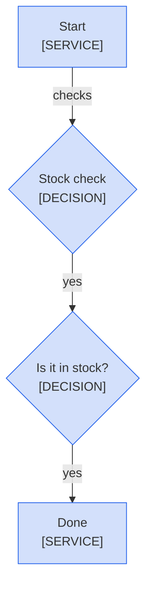

<!--
Purpose: Fixture.
Type: explanation
-->

# Decision

> **Audience:** maintainers, to see one rule fail.

The block draws one decision that asks nothing and one that asks too much.

> **Legend:** *🟦 Orders team*
