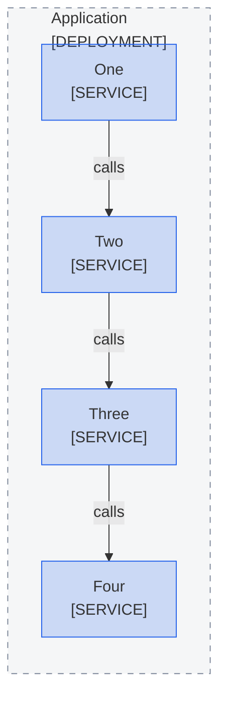
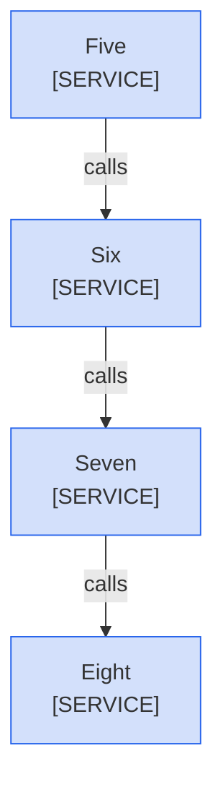

<!--
Purpose: Fixture.
Type: explanation
-->

# Flowchart Line

> **Audience:** maintainers, to see one rule fail twice.

The framed flowchart lacks its flowchart line.

> **Legend:** *🟦 Example team*

The plain flowchart has a flowchart line without its curve.

> **Legend:** *🟦 Example team*
