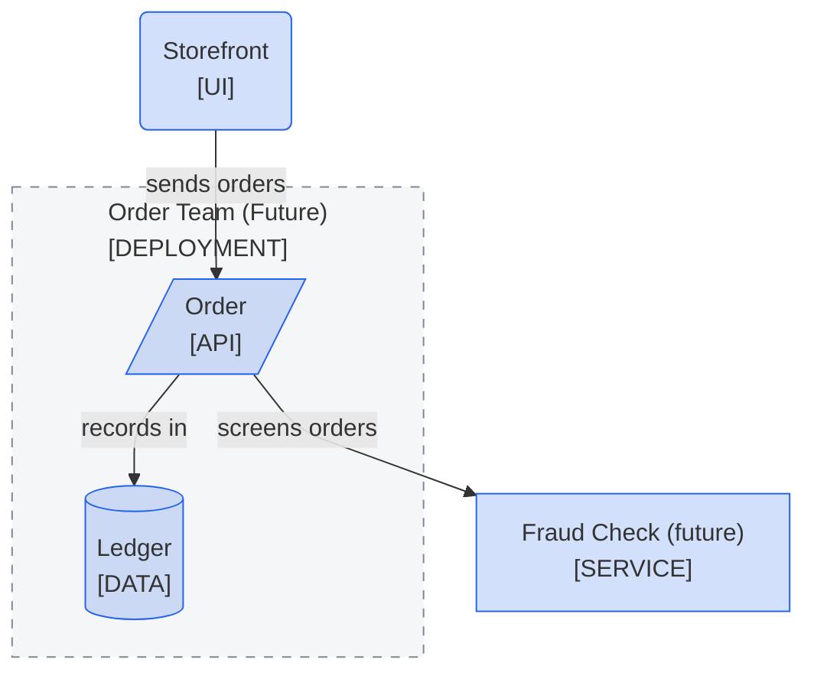

<!--
Purpose: Fixture.
Type: explanation
-->

# Future Marks

> **Audience:** maintainers, to see one rule fail.

The block marks a whole frame as future, and writes a node's suffix in lowercase without the class.

> **Legend:** *🟦 Orders team*
