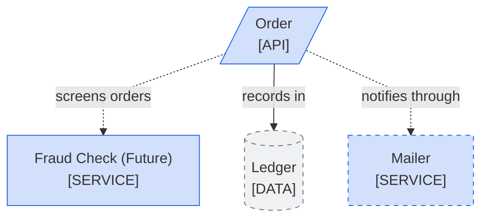
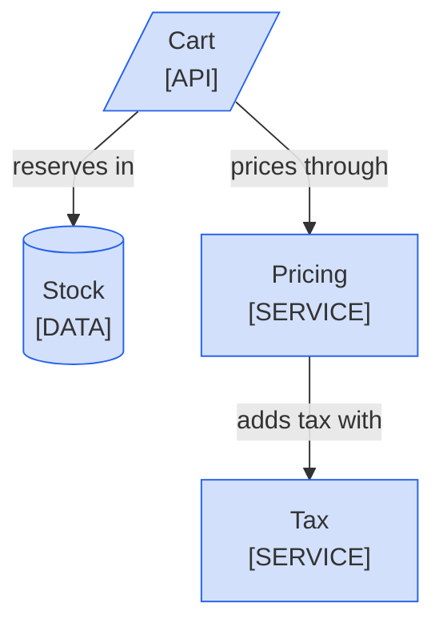

<!--
Purpose: Fixture.
Type: explanation
-->

# Future Parts

> **Audience:** maintainers, to see one rule fail.

The block marks future parts inconsistently, and its legend never explains the dashes.

> **Legend:** *🟦 Orders team*

The next block has no future part, yet its legend still explains dashes.

> **Legend:** *🟦 Orders team · dashed gray = future*
