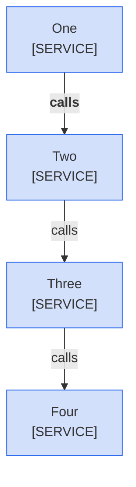
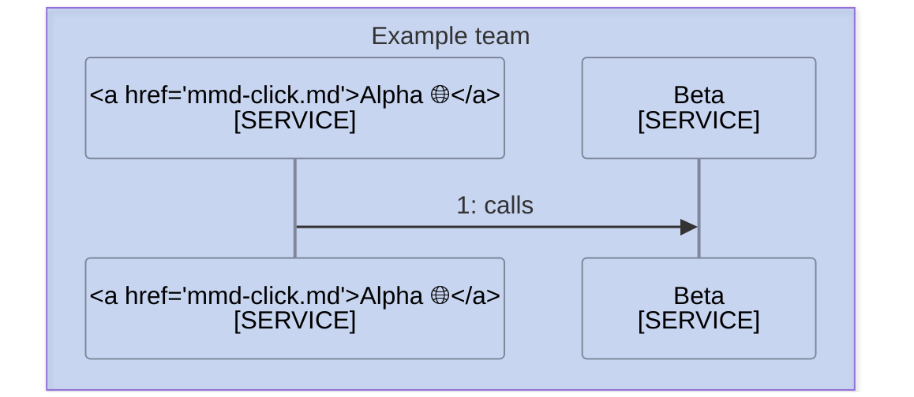

<!--
Purpose: Fixture.
Type: explanation
-->

# Markup

> **Audience:** maintainers, to see one rule fail.

An edge label holds markup other than a line break.

> **Legend:** *🟦 Example team*

A sequence participant holds a link, which only a flowchart title may.

