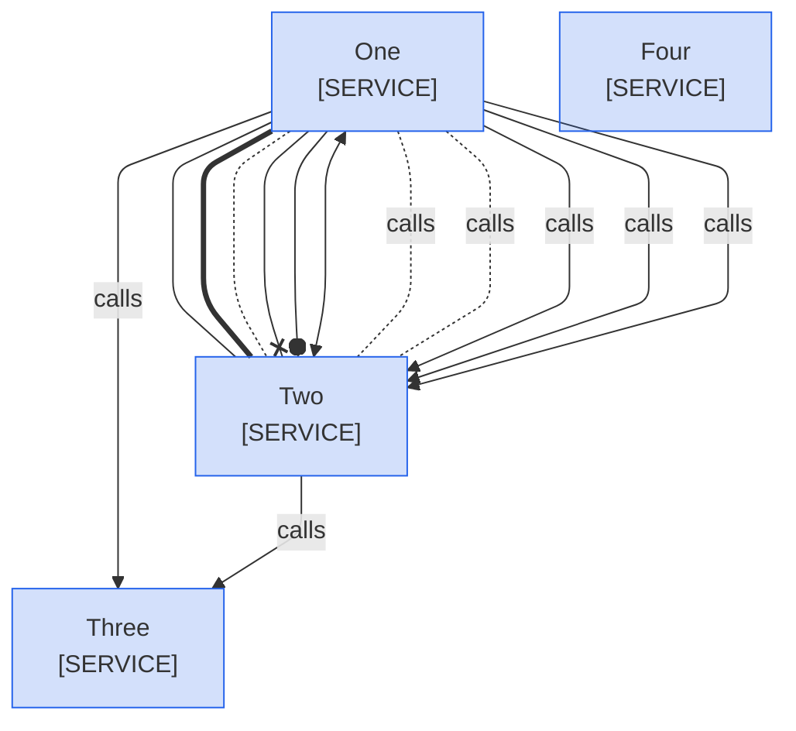

<!--
Purpose: Fixture.
Type: explanation
-->

# Title

> **Audience:** nobody.

## Section

Each edge line below uses a link other than `-->`, `-.->`, or `==>`, draws more than one edge, or names an edge id.

> **Legend:** *🟦 Example team*
