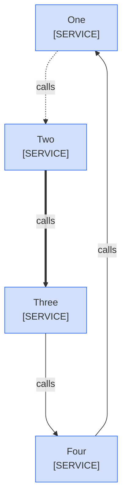

<!--
Purpose: Fixture.
Type: explanation
-->

# Long Arrow

> **Audience:** maintainers, to see one rule fail.

Four edges lengthen an arrow too far or lengthen an inline label.

> **Legend:** *🟦 Example team*
