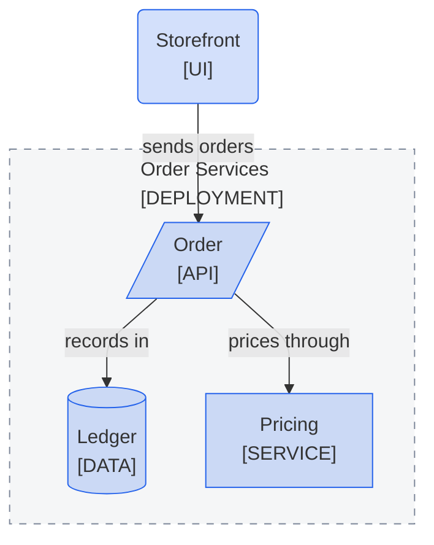

<!--
Purpose: Fixture.
Type: explanation
-->

# Plural Boundary

> **Audience:** maintainers, to see one rule fail.

The block frames one order path in a plural boundary, which Mermaid cannot stack.

> **Legend:** *🟦 Orders team*
