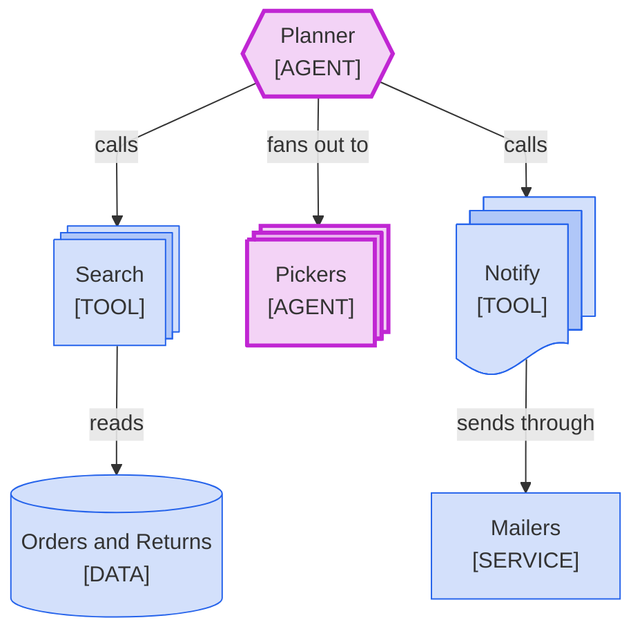

<!--
Purpose: Fixture.
Type: explanation
-->

# Plural Unstacked

> **Audience:** maintainers, to see one rule fail.

The block stacks a tool set and a worker pool, but leaves two plural nodes flat and stacks a tool as documents.

> **Legend:** *🟦 Orders team · 🟪 model call*
