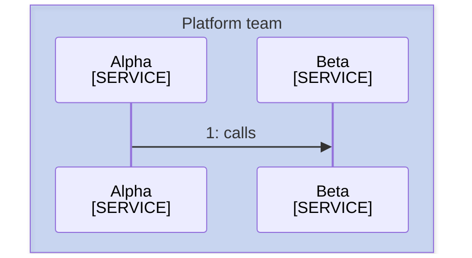
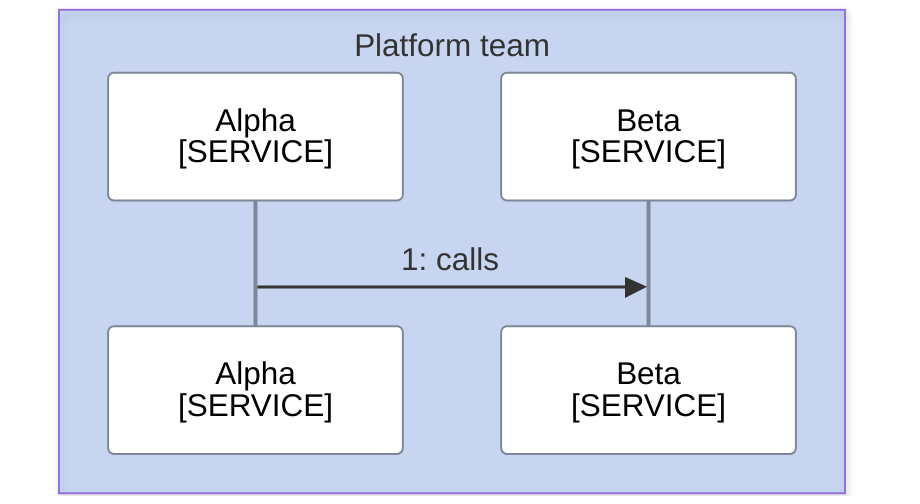

<!--
Purpose: Fixture.
Type: explanation
-->

# Sequence Init

> **Audience:** maintainers, to see one rule fail.

The first block omits the participant line.

The second block changes the participant line.

