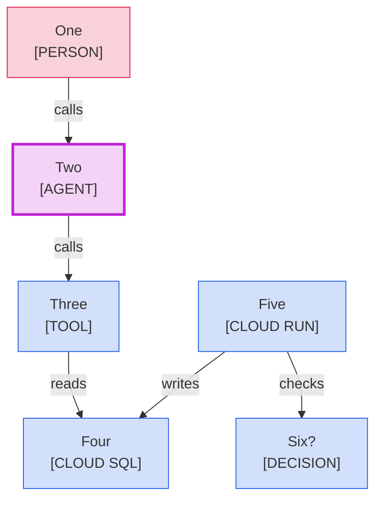

<!--
Purpose: Fixture.
Type: explanation
-->

# Shape Type

> **Audience:** maintainers, to see one rule fail.

The block draws a person, an agent, a tool, a decision, and a Cloud SQL store as rectangles.

> **Legend:** *🟦 Platform team · 🟥 customers · 🟪 model call*
