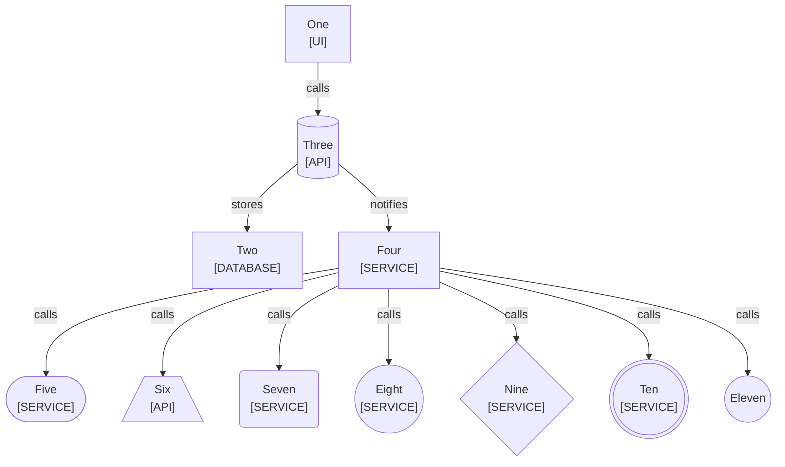

<!--
Purpose: Fixture.
Type: explanation
-->

# Title

Audience: nobody.

## Section

Nodes B, C, and E to K each break the shape rule once.

| Node | Source |
| --- | --- |
| One | - |
| Two | - |
| Three | - |
| Four | - |
| Five | - |
| Six | - |
| Seven | - |
| Eight | - |
| Nine | - |
| Ten | - |
| Eleven | - |
