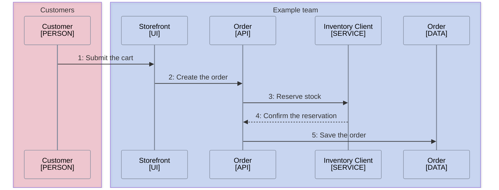

<!--
Purpose: Fixture.
Type: explanation
-->

# Sources Shared Title

> **Audience:** maintainers, to see one rule fail.

## Place an Order

The API reserves stock before it accepts the cart.

1. The customer submits the current cart.
2. The storefront asks the API to create an order.
3. The API asks the inventory client to reserve stock.
4. The inventory client confirms the reservation.
5. The API saves the order.

> **Sources:** *Storefront [mmd-sources.md](mmd-sources.md) · Order [mmd-sources.md](mmd-sources.md) · Inventory Client [mmd-sources.md](mmd-sources.md) · Order [mmd-sources.md](mmd-sources.md)*
