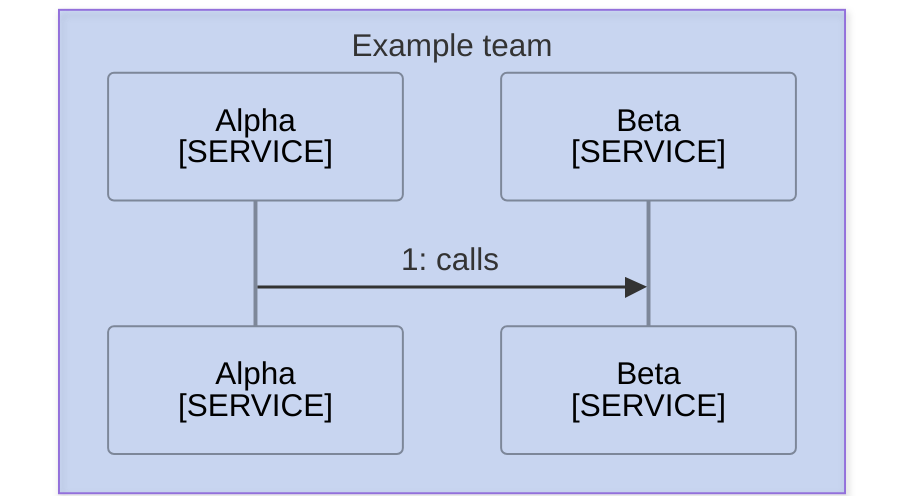
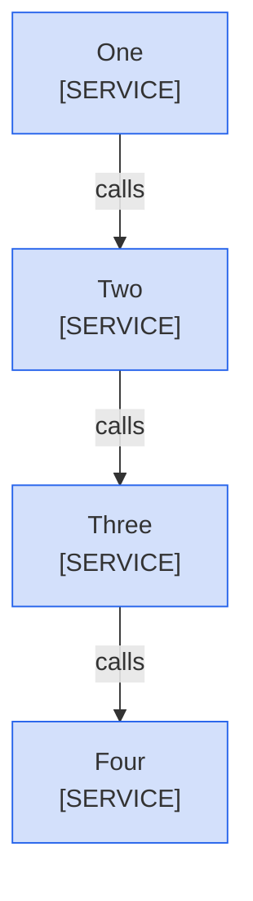

<!--
Purpose: Fixture.
Type: explanation
-->

# Title

> **Audience:** maintainers, to see one rule fail.

## Section

A Sources line names a stranger, holds a bare path, and repeats a title.

> **Sources:** *Alpha [mmd-click.md](mmd-click.md) · Gamma [mmd-click.md](mmd-click.md) · Beta mmd-click.md · Alpha [mmd-click.md](mmd-click.md)*

A flowchart takes a Sources line.

> **Legend:** *🟦 Example team*

> **Sources:** *One [mmd-click.md](mmd-click.md)*

A diagram keeps the retired Node table.

| Node | Source |
| --- | --- |
| Alpha | - |
| Beta | - |

A Sources list is not in italics.

> **Sources:** Alpha [mmd-click.md](mmd-click.md)
