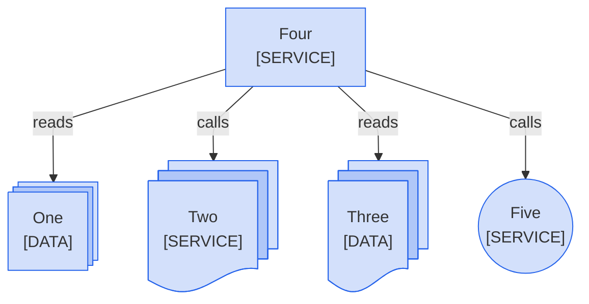

<!--
Purpose: Fixture.
Type: explanation
-->

# Stacked

> **Audience:** maintainers, to see one rule fail.

The block stacks data as rectangles, a service as documents, and uses another '@' shape.

> **Legend:** *🟦 Platform team*
