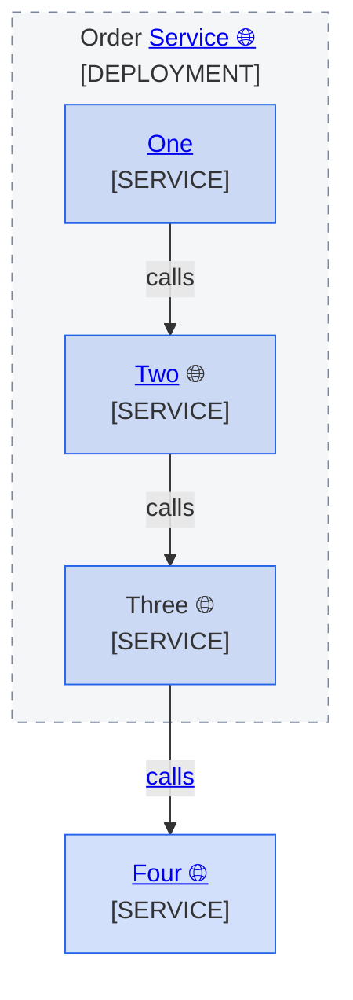

<!--
Purpose: Fixture.
Type: explanation
-->

# Title

> **Audience:** maintainers, to see one rule fail.

## Section

Labels misuse the source link: no globe, a globe outside the link, a globe alone, a half-linked boundary, and a linked edge.

> **Legend:** *🟦 Example team*
