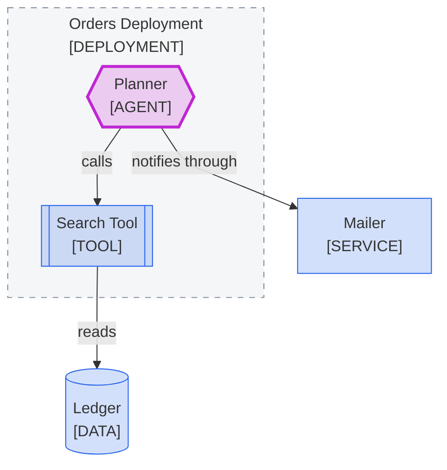

<!--
Purpose: Fixture.
Type: explanation
-->

# Title Repeats Type

> **Audience:** maintainers, to see one rule fail.

The block names a tool "Tool" and a deployment "Deployment", which their tags already say.

> **Legend:** *🟦 Orders team · 🟪 model call*
