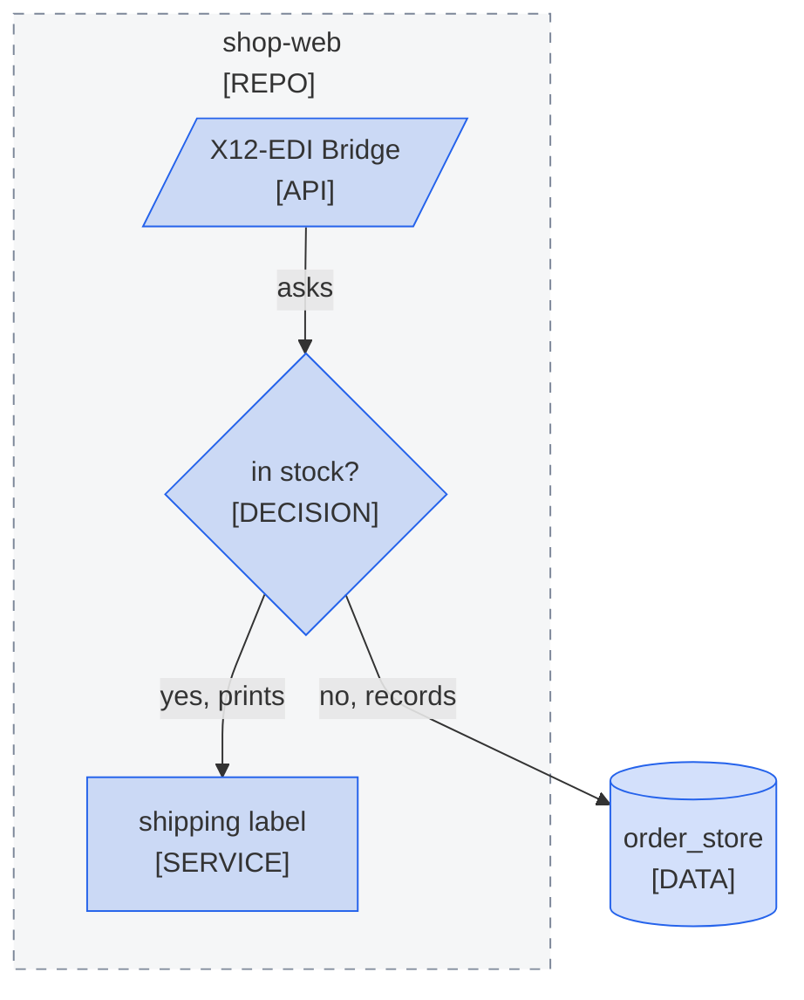

<!--
Purpose: Fixture.
Type: explanation
-->

# Title Wording

> **Audience:** maintainers, to see one rule fail.

The block names one node by its code name, one in lower case, and asks a question in lower case; the repository keeps its real name.

> **Legend:** *🟦 Orders team*
