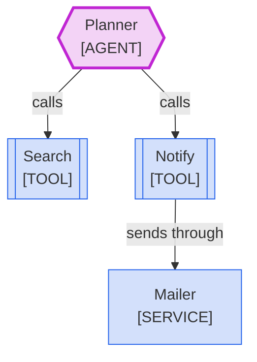

<!--
Purpose: Fixture.
Type: explanation
-->

# Tool Dead End

> **Audience:** maintainers, to see one rule fail.

The block draws a tool that hands its result to nobody.

> **Legend:** *🟦 Orders team · 🟪 model call*
