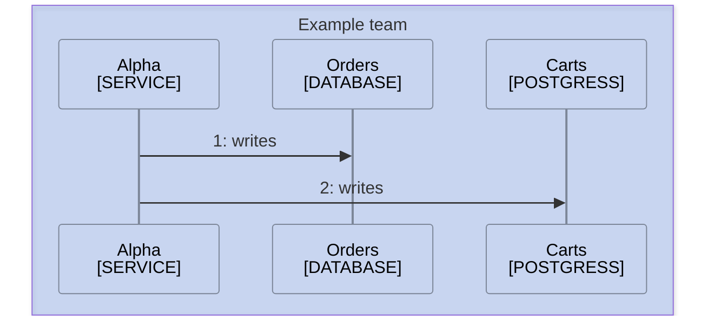

<!--
Purpose: Fixture.
Type: explanation
-->

# Title

> **Audience:** maintainers, to see one rule fail.

## Section

Alpha writes to two stores.

> **Sources:** *Alpha [mmd-click.md](mmd-click.md)*
