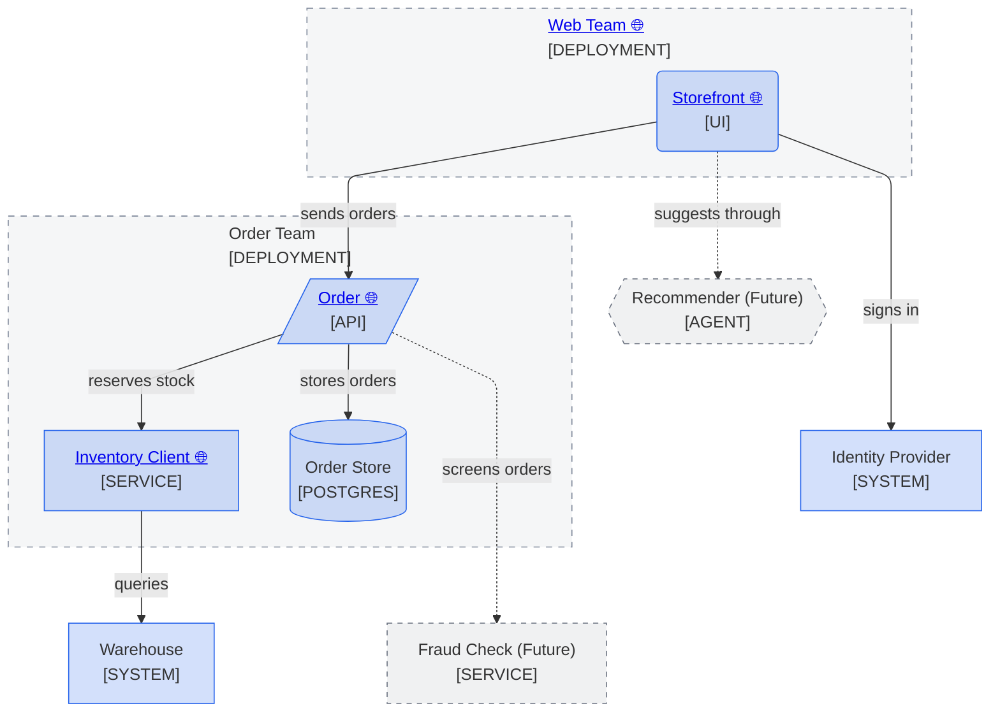

<!--
Purpose: The deployments, who owns each, and the one allowed dependency direction.
Type: explanation
-->

# Architecture

> **Audience:** all teams, to answer what exists and who owns it.

The shop runs as a storefront and an API that two teams own. This guide shows each deployment and the one contract between them.

## Deployments

Two teams ship independently, and only a versioned contract crosses the line
between them.

> **Legend:** *🟦 Example team · dashed gray = future*

The UI never writes inventory directly. The order API coordinates the
reservation so one component owns the transaction boundary.

Sign-in has its own guide: [security/authentication.md](security/authentication.md).
