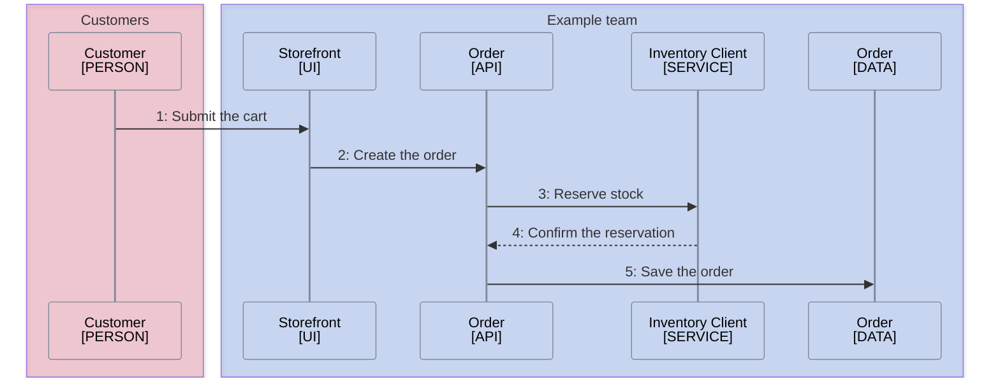

<!--
Purpose: The order of events on each request path that crosses a component boundary.
Type: explanation
-->

# Runtime Flows

> **Audience:** all teams, to trace one request end to end.

A request crosses both deployments in a fixed order. This guide follows each flow step by step.

## Place an Order

The API reserves stock before it accepts the cart.

1. The customer submits the current cart.
2. The storefront asks the API to create an order.
3. The API asks the inventory client to reserve stock.
4. The inventory client confirms the reservation.
5. The API saves the order.

> **Sources:** *Storefront [../src/README.md](../src/README.md) · Order [API] [../src/api.ts](../src/api.ts) · Inventory Client [../src/inventory/client.ts](../src/inventory/client.ts) · Order [DATA] [../src/README.md](../src/README.md)*

An order moves through three states.

| State | Meaning |
| --- | --- |
| `open` | The cart holds items |
| `paid` | Payment cleared |
| `shipped` | The parcel left the warehouse |

> **Sources:** *[../src/api.ts](../src/api.ts) · [Order states](https://example.com/order-states)*

> ⚠️ **Warning:** A cancelled order keeps its payment until the refund clears.

- 🔐 The cart owner alone sees the order.
- 🧾 Each state change writes one history row.
- 📦 Orders stay for seven years.

| Check | Result |
| --- | --- |
| Refund | 🟡 Pending |
| Receipt | ✅ Sent |

> **Legend:** *✅ done · 🟡 pending*

Press ⌘ K to search the orders, and a ✓ beside a row marks it shipped.
