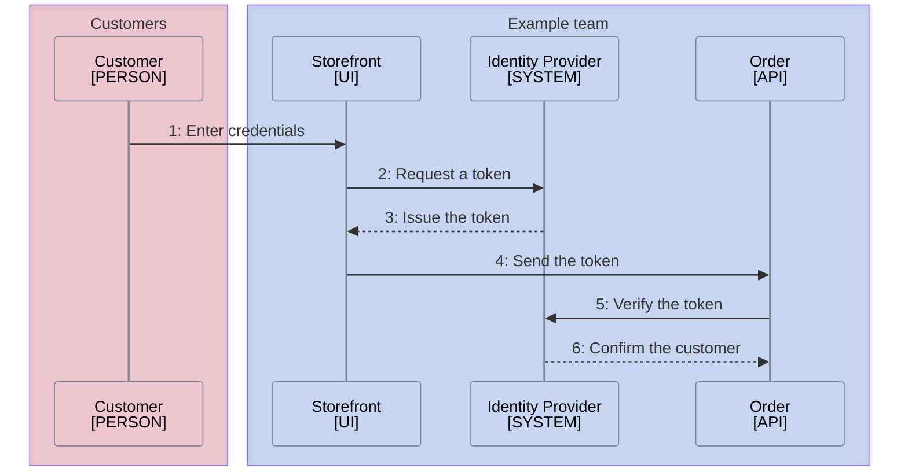

<!--
Purpose: How a customer proves who they are and how the order API trusts each request.
Type: explanation
-->

# Authentication

> **Audience:** all teams, to answer how a request proves who sent it.

Every request carries proof of who sent it. This guide shows how a customer gets that proof and how the API checks it.

## Customer Login

The storefront trades a login for a token, and the API verifies that token on
every call.

> **Sources:** *Storefront [../../src/README.md](../../src/README.md) · Order [../../src/api.ts](../../src/api.ts)*

The API holds no passwords. It rejects any call whose token the identity
provider does not confirm.
