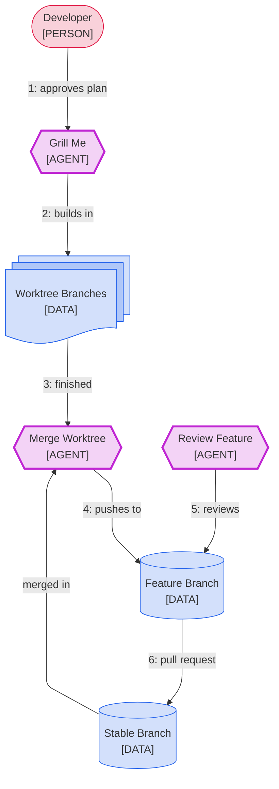
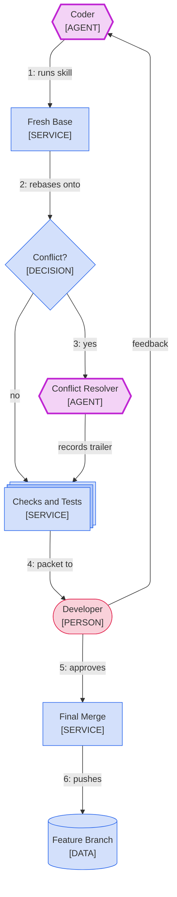
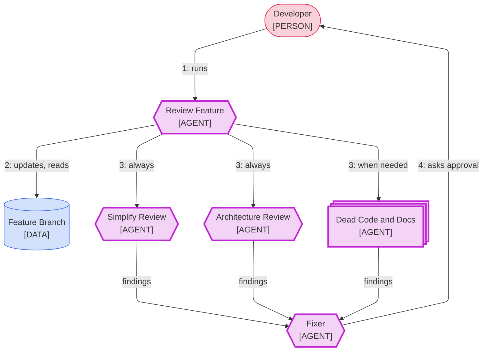

# v002: Layered Agent Workflow

A design for running coding agents across three branch layers with consistent results. You keep
three review gates, and agents work on their own between them. Every proposal cites
[research.md](research.md). Nothing is built yet; the [build order](#build-order) says what each
later round delivers.

## Table of Contents

- [Shared Understanding](#shared-understanding)
- [Commands per Layer](#commands-per-layer)
- [Design](#design)
- [Grill-me Changes](#grill-me-changes)
- [Decisions](#decisions)
- [Risks and Assumptions](#risks-and-assumptions)
- [Build Order](#build-order)
- [Definition of Done](#definition-of-done)

## Shared Understanding

- **Three layers.** `develop` is shared with your team, and `feature/<name>` is cut from it and pushed.
  - Each problem gets a local worktree branch cut from the feature branch, and several can run at once.
- **Two new skills, no background jobs.** `/merge-worktree` runs in a worktree; `/review-feature` runs in the feature checkout. Nothing polls.
- **`develop` arrives at events.** Both skills merge the parent branch into the feature branch first, so you get your team's changes whenever it matters ([D13](research.md#decision-scorecard)).
- **You keep three gates.**
  - ① You read `spec.md` and `plan.md` before a worktree builds anything.
  - ② You review each worktree, with as many feedback rounds as you need, before it merges.
  - ③ You approve the feature review's fixes before the pull request.
- **Nothing reaches the remote unseen.** Agents resolve conflicts, and the resolutions show in the gate that follows.
- **Worktrees show in Herdr.** Inside Herdr, worktrees are created and removed through it, so each gets its own sidebar workspace. See [Herdr](#herdr).
- **All of it is opt-in.** Someone who never runs the new skills keeps today's flow. See [Opt-in](#opt-in).

## Commands per Layer

The pull request to `develop` stays manual.

### Which Skill Runs Where

```text
 develop             feature/<name>  (main checkout)          worktree vN  (.claude/worktrees/vN)
 ───────             ───────────────────────────────          ───────────────────────────────────
                     /grill-me <task>
                       └─ large plan: offers a worktree ────►  new workspace and agent for vN
                                                               spec.md + plan.md written there
                                                               ① you read them, say "proceed"
                                                               agent builds and commits each step
 origin/develop ───────────────────────────────────────────►  /merge-worktree
                                                                 merge develop, rebase, checks
                                                               ② you review the packet
                                                                 feedback: agent revises, run again
 feature/<name> on the remote  ◄──── merge --no-ff, push ────    approve: merge, push, remove vN
 origin/develop ───► /review-feature
                       pull, merge develop, simplify + architecture
                     ③ you approve the fixes; they are pushed
 develop  ◄────────  you open the pull request
```

### Feature Layer

Branch `feature/<name>`, in the main checkout. Keep no unpushed commits here, so each pull fast-forwards.

| When | You Run | What Happens | Ready |
| --- | --- | --- | --- |
| Once per machine | Nothing: your dotfiles set `rerere.enabled` globally | Repeated conflicts replay their recorded resolution | ✅ After the dotfiles change |
| Once per repository | Add `.claude/worktrees/` to `.gitignore` or `.git/info/exclude` | Worktree folders stay untracked, and grill-me starts offering worktrees | ✅ Today |
| Once per feature | `git switch -c feature/<name> develop`, then `git push -u origin feature/<name>` | The shared feature branch exists | ✅ Today |
| You start any task | `/grill-me <task>` | A plan; for a large one, grill-me offers a new worktree | ✅ Today; 🟡 offer after v002 build |
| The worktrees you want are merged | `/review-feature` | Pulls, merges `develop`, then simplify and architecture review; you approve fixes at ③ | 🟡 v005 |
| Gate ③ is clean | Open the pull request to `develop` | Ships the feature | ✅ Today |

### Worktree Layer

Branch `worktree-vN`, in `.claude/worktrees/vN`. It is never pushed; its commits reach the remote only inside the feature branch.

| When | You Run | What Happens | Ready |
| --- | --- | --- | --- |
| You start a problem | Accept grill-me's offer. By hand: `herdr worktree create`, or `claude -w vN` | A worktree at the latest feature branch, with its own agent | ✅ By hand; 🟡 offer after v002 build |
| The plan is drafted | Nothing: grill-me writes `spec.md` and `plan.md`, then waits | The worktree's agent points you to both files | 🟡 v002 build; today the plan shows in chat |
| ① The files are written | Read them; give feedback, or say proceed | Feedback revises both files; proceed starts the build | 🟡 v002 build |
| The agent builds | Nothing: commits need no approval here once the dotfiles rule lands | Each step: build, simplify, checks, reviewers, fixes, commit | ✅ Today; 🟡 free commits in v004 |
| The plan is done | `/merge-worktree` | Merges `develop`, rebases, runs checks, shows the [review packet](#review-packet) | 🟡 v004 |
| ② The packet arrives | Review it; give feedback, or approve | Feedback: the agent revises, then you run it again. Approve: merge, push, remove | 🟡 v004 |

> **Legend:** *✅ works today · 🟡 waits for the build named*

> 💡 **Tip:** Keep three or fewer worktrees active, and split work so they touch different files.
> DORA's teams keep three or fewer active branches ([Q1](research.md#branch-lifetime)), and
> practitioners split by boundary before agents start ([Q6](research.md#q6-practitioner-worktree-workflows)).

## Design

Three views: the whole system, merging one worktree, and the review before a pull request.
`develop` and `feature/<name>` are examples; no skill or rule names a branch.

### Branch Names

Each skill finds its branches; none is hardcoded.

| Branch | How a Skill Finds It | Stored In |
| --- | --- | --- |
| A worktree's feature branch | grill-me records the branch it cut the worktree from; a hand-made worktree uses the main checkout's branch | `branch.worktree-vN.parent`, local git config |
| A feature branch's parent | The first skill run asks once, suggesting the remote's default branch, then remembers it | `branch.<feature>.parent`, local git config |

The keys are local, so each clone and each person keeps their own. A parent can be any branch, such as `main` or `release/2.0`.

### Overview

You review at three gates, and everything else runs on its own.



> **Legend:** *🟦 your branches · 🟥 you · 🟪 model call*

1. You approve a worktree's `spec.md` and `plan.md` at gate ①.
2. The agent builds the plan in its own worktree branch, committing each step.
3. When the plan is done, `/merge-worktree` merges `develop` in and rebases the worktree onto the result ([D2](research.md#decision-scorecard)).
4. After your review at gate ②, it merges the worktree and pushes the feature branch.
5. `/review-feature` reviews everything merged since the last review, and you approve its fixes at gate ③.
6. You open the pull request. A shared branch is merged, never rebased ([D1](research.md#decision-scorecard)).

### Merge Worktree

`/merge-worktree` runs inside the worktree and pushes to the remote feature branch. Git will not move a branch checked out in another folder ([Q2](research.md#isolation)), and the remote one is checked out nowhere.



> **Legend:** *🟦 your scripts and branches · 🟥 you · 🟪 model call*

1. The skill stops and lists the files if the worktree has uncommitted changes, since those were never reviewed.
2. It fetches, then builds a fresh base: the remote feature branch with its remote parent merged in. The worktree rebases onto it, with `rerere` on.
3. On a conflict, the resolver decides by the plan within its scope; elsewhere the feature branch's behavior wins.
   - Each judgment call lands in a `Clash-resolved:` commit trailer.
   - Models resolve only about half of conflicts correctly, so the checks and your review decide ([Q3](research.md#q3-conflict-resolution-by-models)).
4. The checks run on the rebased branch, and you get the review packet at gate ②.
   - Feedback goes to the coder, which revises and commits. Then you run `/merge-worktree` again.
5. You approve. It merges the worktree onto the fresh base with `--no-ff` and pushes it to the remote feature branch.
   - If another merge pushed first, the push is rejected. It builds a new base and shows a new packet; nothing is lost.
6. The push lands. The skill deletes `worktree-vN` and its folder, through Herdr when it runs there ([Q6](research.md#q6-practitioner-worktree-workflows)).

### Review Packet

At gate ②, one message holds everything you need to judge the worktree:

- the spec and plan, with every step ticked
- the diff size against the feature branch, and the files touched
- the check and test results
- the review findings: what was fixed, and anything still open
- every `Clash-resolved:` line, from `develop` and from the rebase
- how to verify it yourself: what to run or open, and what you should see

### Review Feature

`/review-feature` reads the merged work as one change before the pull request.



> **Legend:** *🟦 your branches · 🟥 you · 🟪 model call*

1. You run `/review-feature` in the feature checkout once the worktrees you want in the pull request are merged.
2. It runs `git pull --ff-only`, merges the remote parent, and reads the range since the `refs/reviewed/<branch>` marker.
   - It lists every `Clash-resolved:` trailer in that range, so you see each agent-resolved conflict once more.
3. Two reviewers always run, because you asked for both:
   - Simplify finds duplication and needless code across the solutions.
   - Architecture checks that the solutions fit together and follow the project's structure.
   - A dead-code reviewer joins when the range deletes or replaces functions, and a docs reviewer when it edits a guide or a README.
4. The fixer applies confirmed findings and shows you the diff at gate ③. On approval it commits, pushes, and moves the marker.

## Grill-me Changes

The v002 build changes grill-me in three ways, and handles Herdr. The v003 build adds a research step.

### Files Before the Gate

Today grill-me shows the plan in chat, waits for Proceed, then writes the files. You want to read the files first, so the order changes:

1. grill-me interviews you and drafts the plan.
2. For a large plan where the offer applies, it asks where to write: "In a new worktree" or "Here" (see [Worktree Switch](#worktree-switch)).
3. It writes `spec.md` and `plan.md` there and points you to them.
4. Gate ①: you give feedback, which revises the files, or say proceed. Cancel deletes the draft folder and its reservation.

### Worktree Switch

- **Detect.** A checkout is a linked worktree when `git rev-parse --git-dir` and `--git-common-dir` differ. `next_version.py` already uses this test.
- **Offer only where worktrees are used.** Outside a linked worktree, when `.claude/worktrees/` is git-ignored or another worktree exists.
- **Split first.** A plan with more than one concern becomes one plan per concern ([Q4](research.md#q4-work-sizing)).
- **Recommend a worktree** at about 400 expected changed lines, or a second top-level folder, a proxy with no source behind it.
- **Offer midway too.** When a deviation sends the plan back through the gate, grill-me offers "Continue in a new worktree".

Choosing a new worktree runs `new_worktree.py` once, which does these steps:

1. It reserves version N as `refs/grill-me/vN` through `next_version.py`, if the run has no version yet.
2. It fetches the branch's upstream and cuts from it when the branch is only behind, so the base is current and your checkout is untouched.
   - It warns and uses HEAD when the fetch fails or the branch has diverged. A midway move always uses HEAD, which its carried edits are against.
3. It creates `.claude/worktrees/vN` on branch `worktree-vN`, and deletes the reservation ref. The folder and the branch name now hold N, since the build widens `next_version.py`'s name rule.
4. Midway only, it copies the plan's uncommitted files and its spec folder into the new worktree, then resets them here. It never uses `git stash`, which every worktree shares.
5. It prints the spec and plan paths inside the worktree, where grill-me writes them.
6. The work moves to the worktree, as [Herdr](#herdr) describes; elsewhere through Claude Code's `EnterWorktree`, or a printed `cd <path>`.

### Herdr

Herdr's sidebar lists workspaces, and a worktree gets one only when Herdr creates or opens it. So when `HERDR_ENV` is `1` and `herdr pane current` answers, the script works through Herdr:

- **Create.** `herdr worktree create` makes the worktree and its sidebar workspace together. When it fails, the script stops and says why, rather than make a worktree the sidebar cannot see.
- **Hand off.** The script prints a `handoff` command: `herdr agent start vN` in that workspace's pane, prompted to resume grill-me at gate ① from the written files.
  - The files carry the interview, so the first session is free for the next task.
- **Remove.** `/merge-worktree` cleans up with `herdr worktree remove`, so the workspace leaves the sidebar with the folder.
- **Adopt by hand.** A worktree made by `claude -w` joins the sidebar with `herdr worktree open --path .claude/worktrees/vN`.

Outside Herdr, the script uses `git worktree add`, and the session moves with `EnterWorktree`.

### Research

grill-me looks up only the codebase and local docs today. A new `/research` skill checks how proven sources solve a design question, and grill-me runs it when a decision has prior art.

- **When.** Architecture, workflow, data model, algorithm or security choices. Never for bug fixes or local changes.
- **How.** Parallel searches that favor peer-reviewed, survey and vendor sources, then a spot-check that drops any claim its source does not back.
- **Output.** `research.md` beside `spec.md`, each finding with a link and an evidence label, plus a decision scorecard. Each picker option cites its source.
- **Alone.** You can run `/research <question>` without grill-me, and `/review-feature`'s architecture reviewer can use it.

This round's [research.md](research.md) is the model it follows.

### Opt-in

Someone who uses grill-me alone, on the branch they are on, keeps today's flow:

- **grill-me offers a worktree only where worktrees are used.** In a solo repository it never asks, and builds in place as today.
- **The one visible change** is gate ①: they read `spec.md` and `plan.md` before saying proceed, not after.
- **`/merge-worktree` and `/review-feature` run only when invoked.** No hook or loop runs them.
- **The new AGENTS.md rules are scoped.** Each names one of the new skills or a `worktree-vN` branch.

## Decisions

### Decided

| Decision | Your Answer |
| --- | --- |
| The new skills | `/merge-worktree` in a worktree, `/review-feature` in the feature checkout |
| What from `develop` belongs in the feature branch | Everything, merged at each skill run |
| A conflict from `develop` or a rebase | The agent resolves it; the checks and your next gate decide |
| Where you review | Gate ① the plan files, gate ② each worktree, gate ③ the review's fixes |
| Pushing the feature branch | Automatic once you approve at gate ② or ③ |
| The pull request to `develop` | Stays manual |
| Research on design questions | A separate `/research` skill that grill-me runs when a decision has prior art |
| Under Herdr, who continues the worktree | A new agent in its workspace, so its sidebar badge shows when it needs you |
| Commits inside a worktree | Commit freely once gate ① approves the plan; gate ② reviews it all |
| Merge style for a worktree | `--no-ff`: one merge commit per solution, one revert each, and the review can read the merges |

### User-Level AGENTS.md

Your shared agent policy lives in your dotfiles at `home/ai/AGENTS.md`. Skills trigger from their own descriptions, so it needs no skill list, only these rules:

| Change | Why |
| --- | --- |
| Add: "Update a shared branch by merging its parent; rebase only local worktree branches." | Agents update branches outside the skills too |
| Add: "Approving at gate ② or ③ approves that merge's commit and push." | The skills push without a second prompt |
| Add: "In a `worktree-vN` branch whose plan you approved, commits need no approval." | Builds run without commit prompts |
| Amend the review rule: run the passes before showing "the diff or the review packet" | Gate ② |

## Risks and Assumptions

### Risks

- **An agent-resolved conflict passes the checks but is wrong.** Semantic conflicts can merge cleanly ([Q1](research.md#branch-lifetime)).
  - Every judgment call is a `Clash-resolved:` trailer, shown at gate ② and again at gate ③.
- **The local feature branch falls behind the remote.** New worktrees start from the fetched upstream, and `/review-feature` pulls first; a fast-forward pull fails safely if you left unpushed commits.
- **Two worktrees merge at once.** The second push is rejected, and the skill rebuilds its base and shows a new packet.
- **Approval fatigue.** Three gates, each with the work checked, keep your attention where it counts.
- **A moved file carries unrelated edits.** The mid-run move moves whole files, and lists every file before it moves anything.
- **Herdr's CLI changes.** The script reads Herdr's JSON replies and never guesses IDs. A failed create stops the run; a missing pane ID only skips the hand-off, with a warning.

### Assumptions

- Everything in `develop` belongs in the feature branch. You confirmed this.
- `develop`, `feature/<name>` and per-problem worktrees match how you work in your projects today.
- Each project can run its checks from a worktree, and its AGENTS.md names the check command.
- Herdr's `worktree create`, `open` and `remove` behave as their help text says. The v002 build tests this first.

## Build Order

| Round | Delivers | Ready When |
| --- | --- | --- |
| v002 build | grill-me: files before the gate, the worktree offer, detect, create, move, and Herdr | Its self-test covers each rule; an end-to-end run in Herdr and outside it passes |
| v003 | `/research`, and the grill-me line that runs it | A run on a sample question writes a `research.md` whose every finding has a link and a label |
| v004 | `/merge-worktree`: fresh base, rebase, packet, feedback loop, merge, push, cleanup | Two worktrees merge in a scratch repository, one after a rejected push |
| v004, dotfiles | The user-level AGENTS.md rules | `nix flake check` passes; you run `rebuild` |
| v005 | `/review-feature`: pull, `develop` merge, reviewers, fixer and marker | It reviews a merged range, and its fixes wait for gate ③ |

Each round gets its own grill-me session and review.

## Definition of Done

- You can follow the [command tables](#commands-per-layer) on each layer without asking what to run next.
- Every proposal links to the evidence behind it in `research.md`, or names your decision.
- You have answered every [decision](#decided) before the build that uses it.
- Someone who never opts in can run `/grill-me` on their own branch as before, with gate ① as the only change.
